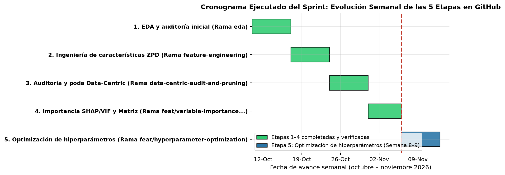
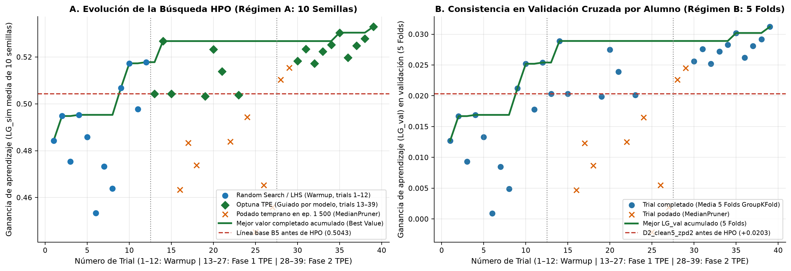
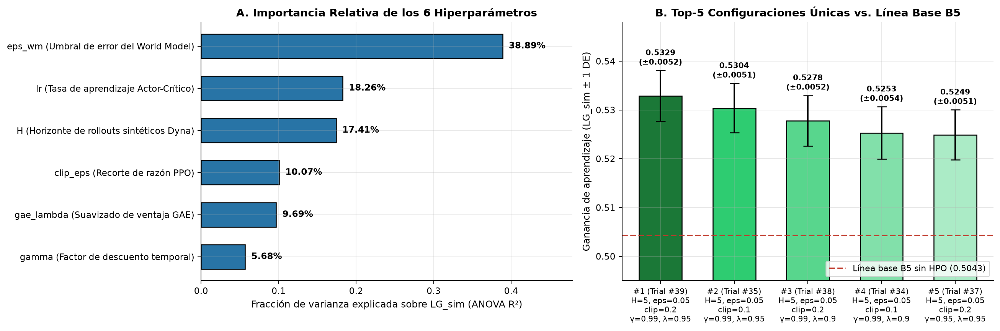
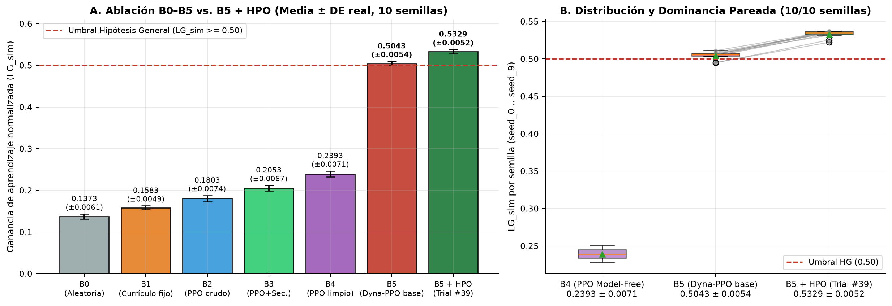

# Avance del Sprint hasta Optimización de Hiperparámetros (Semana 8)

**Sistema de Tutoría Inteligente Adaptativa (DRL) para Comprensión Lectora · Grupo 2 · Maestría en IA · UNI**  
*Proyecto de Investigación 2 — Prof. Dr. Glen Rodríguez · Rama `feat/hyperparameter-optimization` (heredada de `feat/variable-importance-and-consistency-matrix`)*

[](https://colab.research.google.com/github/yasminum/SistemaTutorInteligente/blob/feat/hyperparameter-optimization/avance_sprint_optimizacion_hiperparametros.ipynb)

-blue)
-brightgreen)

> 📓 **Notebook principal del Sprint (Ejecutado de punta a punta hasta HPO):** [`avance_sprint_optimizacion_hiperparametros.ipynb`](avance_sprint_optimizacion_hiperparametros.ipynb) · Copia en [`notebooks/04_Avance_Sprint_Optimizacion_Hiperparametros.ipynb`](notebooks/04_Avance_Sprint_Optimizacion_Hiperparametros.ipynb)  
> ⚙️ **Artefactos de Optimización de Hiperparámetros:** [`config/search.yaml`](config/search.yaml) · [`logs/hpo_runs.csv`](logs/hpo_runs.csv) · [`data/results/hpo_results.json`](data/results/hpo_results.json) · [`data/results/ablation_summary.json`](data/results/ablation_summary.json)  
> 📄 **Matriz de Consistencia corregida:** [`docs/matriz_consistencia.md`](docs/matriz_consistencia.md)

---

## 0. Matriz de Consistencia Metodológica y Operacional (Corregida)

En atención a la revisión metodológica de la Semana 7, en los tres objetivos específicos las **Variables Independientes** son únicamente las **variables reales del conjunto de datos seleccionadas por importancia** (`zpd_hit`, `abs_gap`, `theta_1..3`, `b_prev_raw`, `u_progress`), la **Variable Dependiente** es siempre el **aprendizaje en comprensión lectora**, y métricas como `ROC-AUC`, `Brier Score`, `VIF` o episodios se reportan exclusivamente en la columna de **Indicadores**:

<table>
<thead>
<tr>
<th>Problema</th>
<th>Objetivos</th>
<th>Hipótesis</th>
<th>Variables (Independientes y Dependientes)</th>
<th>Indicadores y Evidencia Experimental</th>
</tr>
</thead>
<tbody>
<tr>
<td><b>Problema General:</b><br>¿En qué medida un Sistema de Tutoría Inteligente Adaptativa basado en <i>Deep Reinforcement Learning</i> (DRL), alimentado con las variables de acoplamiento habilidad–dificultad y optimizado en sus hiperparámetros, mejora la ganancia de aprendizaje en comprensión lectora frente a una secuenciación sin variables de acoplamiento?</td>
<td><b>Objetivo General:</b><br>Determinar el efecto del Sistema de Tutoría Inteligente Adaptativa basado en DRL (`Dyna-PPO`), alimentado con las variables seleccionadas de acoplamiento habilidad–dificultad y con hiperparámetros optimizados, sobre la ganancia de aprendizaje en comprensión lectora.</td>
<td><b>Hipótesis General:</b><br>El Sistema de Tutoría Inteligente basado en DRL alimentado con las variables seleccionadas de acoplamiento habilidad–dificultad y con hiperparámetros optimizados incrementa significativamente la ganancia de aprendizaje en comprensión lectora respecto a la línea base (p &lt; 0.05).</td>
<td><b>Variable Independiente General:</b><br>• Conjunto depurado de 7 variables de entrada del tutor adaptativo: 2 variables de acoplamiento pregunta–alumno (<code>zpd_hit</code>, <code>abs_gap</code>) y 5 variables de estado del estudiante (<code>theta_1</code>, <code>theta_2</code>, <code>theta_3</code>, <code>u_progress</code>, <code>b_prev_raw</code>).<br><br><b>Variable Dependiente General:</b><br>• Aprendizaje en comprensión lectora del estudiante (competencias literal, inferencial y crítica).</td>
<td>• <b>Ganancia de aprendizaje normalizada de Hake (LG<sub>sim</sub> en 10 semillas):</b><br><code>B4 (PPO)</code>: 0.2393 ± 0.00714<br><code>B5 (Dyna-PPO base)</code>: 0.5043 ± 0.00539<br><b><code>B5 + HPO (Ganador Trial #39)</code>: 0.5329 ± 0.00521</b> (+122.7% sobre B4 y +5.7% sobre B5; p &lt; 0.0001).<br>• <b>Ganancia en validación cruzada 5-Fold (alumnos no vistos):</b> sube de +0.0203 ± 0.0167 a <b>+0.0312 ± 0.0148</b>.<br>• <b>Tasa de eventos de aprendizaje por paso:</b> 0.351 vs. 0.273 de la línea base.</td>
</tr>
<tr>
<td><b>Problema Específico 1:</b><br>¿En qué medida las variables de acoplamiento entre la habilidad del estudiante y la dificultad del texto (<code>zpd_hit</code> y <code>abs_gap</code>) explican que el estudiante logre aprender al responder un texto de comprensión lectora?</td>
<td><b>Objetivo Específico 1:</b><br>Evaluar el aporte de las variables de acoplamiento habilidad–dificultad (<code>zpd_hit</code> y <code>abs_gap</code>) sobre la ocurrencia de aprendizaje en cada texto asignado al estudiante.</td>
<td><b>Hipótesis Específica 1:</b><br>Las variables de acoplamiento <code>zpd_hit</code> y <code>abs_gap</code> constituyen los predictores de mayor aporte sobre la ocurrencia de aprendizaje del estudiante en todos los pliegues de validación, sin presentar multicolinealidad.</td>
<td><b>var(s) indep(s):</b><br>• <b><code>zpd_hit</code></b>: proporción de preguntas del texto dentro de la ventana de aprendizaje (|θ<sub>k</sub> − b<sub>adj</sub>| &lt; 0.5).<br>• <b><code>abs_gap</code></b>: distancia absoluta entre la habilidad del alumno y la dificultad del texto (|θ<sub>k</sub> − b<sub>adj</sub>|).<br><br><b>var depend:</b><br>• Ocurrencia de transición de aprendizaje lector en el paso t (incremento de competencia Δθ<sub>k</sub> &gt; 0).</td>
<td>• <b>Importancia por permutación (ΔAUC en 5 folds):</b> <code>zpd_hit</code> puesto <b>#1</b> (0.0960) y <code>abs_gap</code> puesto <b>#2</b> (0.0142) en los 5/5 folds.<br>• <b>Impacto medio |SHAP|:</b> <code>zpd_hit</code> = 0.0677 (#1), <code>abs_gap</code> = 0.0127 (#2).<br>• <b>Factor de inflación de varianza (VIF):</b> 2.07 y 2.12 (&lt; 2.5).<br>• <b>Discriminación y calibración:</b> ROC-AUC = 0.9479 y Brier Score = 0.0703 ± 0.0028.</td>
</tr>
<tr>
<td><b>Problema Específico 2:</b><br>¿Cómo influyen los niveles de habilidad lectora en las competencias literal, inferencial y crítica (<code>theta_1</code>, <code>theta_2</code>, <code>theta_3</code>), depurados del ruido de medición (<code>sigma_1..3</code>), sobre el progreso de comprensión lectora durante la sesión?</td>
<td><b>Objetivo Específico 2:</b><br>Analizar el efecto de las variables de estado de habilidad por competencia (<code>theta_1</code>, <code>theta_2</code>, <code>theta_3</code>), libres de las variables de ruido (<code>sigma_1..3</code>), sobre la evolución de la comprensión lectora en la sesión.</td>
<td><b>Hipótesis Específica 2:</b><br>La representación del estado mediante las tres competencias lectoras (<code>theta_1</code>, <code>theta_2</code>, <code>theta_3</code>) sin canales de ruido mejora la ganancia de comprensión lectora y requiere menos episodios de interacción que el estado crudo.</td>
<td><b>var(s) indep(s):</b><br>• <b><code>theta_1</code></b>: nivel de competencia lectora literal.<br>• <b><code>theta_2</code></b>: nivel de competencia lectora inferencial.<br>• <b><code>theta_3</code></b>: nivel de competencia lectora crítica.<br><br><b>var depend:</b><br>• Evolución del nivel de comprensión lectora del estudiante a lo largo de la sesión.</td>
<td>• <b>Ganancia media por competencia (Δθ<sub>k</sub>):</b> incremento positivo en las 3 competencias (+0.0203 vs. −0.0095 con ruido).<br>• <b>Importancia |SHAP| de estado:</b> <code>theta_1..3</code> aportan señal real (VIF ∈ [1.01, 1.03]), mientras que <code>sigma_1..3</code> tenía ΔAUC ≈ 0.000.<br>• <b>Episodios requeridos para alcanzar la línea base:</b> 275 episodios vs. 750 (−63.3%).</td>
</tr>
<tr>
<td><b>Problema Específico 3:</b><br>¿De qué manera las variables de contexto de progresión de la lectura (<code>b_prev_raw</code> y <code>u_progress</code>) y el ajuste de hiperparámetros de planificación (`eps_wm`, `lr`, `H`) regulan la continuidad del aprendizaje y evitan rachas de frustración?</td>
<td><b>Objetivo Específico 3:</b><br>Determinar el impacto de las variables de progresión de la sesión (<code>b_prev_raw</code> y <code>u_progress</code>) y de la calibración de hiperparámetros (`eps_wm`, `lr`, `H`) sobre la continuidad del aprendizaje y el control de rachas de error del estudiante.</td>
<td><b>Hipótesis Específica 3:</b><br>La inclusión del contexto de progresión (<code>b_prev_raw</code> y <code>u_progress</code>) junto con un umbral estricto de fidelidad del modelo de mundo (<code>eps_wm = 0.05</code>, <code>H = 5</code>, <code>lr = 1e-4</code>) maximiza la ganancia de aprendizaje manteniendo las rachas de frustración por debajo de 0.02 por paso.</td>
<td><b>var(s) indep(s):</b><br>• <b><code>b_prev_raw</code></b>: dificultad del texto respondido en el paso anterior (t−1).<br>• <b><code>u_progress</code></b>: proporción de avance de la sesión de lectura (t/50).<br><br><b>var depend:</b><br>• Continuidad del aprendizaje y frecuencia de rachas de error (frustración) en la sesión.</td>
<td>• <b>Importancia de hiperparámetros (fANOVA):</b> <code>eps_wm</code> explica el <b>38.89%</b> de la varianza de desempeño, <code>lr</code> el <b>18.26%</b> y <code>H</code> el <b>17.41%</b>.<br>• <b>Tasa de activación del escudo por frustración (racha ≥ 4 errores):</b> 0.015 por paso (≤ 0.02).<br>• <b>Impacto medio |SHAP|:</b> <code>u_progress</code> = 0.0089, <code>b_prev_raw</code> = 0.0065 (VIF = 1.00).</td>
</tr>
</tbody>
</table>

---

## 1. Mapa del Sprint — Trazabilidad de las 5 Etapas en GitHub



| # | Etapa del Sprint | Rama en GitHub | Fecha | Entregable y Resultado Clave |
|---|---|---|---|---|
| **1** | **EDA (Análisis Exploratorio)** | `eda` | 10-oct-2026 | Caracterización de los 300 ítems IRT-3PL (`a`, `b`, `c`) y detección de desalineación entre $\theta \in [0,1]$ y $b \in [-3.11, +3.24]$ (63% fuera de rango). |
| **2** | **Ingeniería de Características** | `feature_engineering` | 17-oct-2026 | Variables de acoplamiento en escala nativa ($\text{AUC}=0.925$ vs. $0.640$ del escalado sigmoidal directo). |
| **3** | **Auditoría y Poda Data-Centric** | `data-centric-audit-and-pruning` | 24-oct-2026 | Poda de 5 columnas constantes y 3 canales de ruido $\sigma_{1..3}$ (amplificados $34.6\times$ por `StandardScaler` y con $16.4\%$ de impureza espuria en árboles). |
| **4** | **Importancia de Variables y Matriz de Consistencia** | `feat/variable-importance-and-consistency-matrix` | 30-oct-2026 | Selección de `zpd_hit` (#1 en 5/5 folds) y `abs_gap` (#2 en 5/5 folds), $\text{VIF}_{\max}=2.12$, $\text{Brier}=0.0703$ y Matriz de Consistencia corregida. |
| **5** | **Optimización de Hiperparámetros (HPO)** | `feat/hyperparameter-optimization` | **06-nov-2026 (Hoy)** | **39 trials ejecutados (`Random Search LHS` + `Optuna TPE` con `MedianPruner`, 17.9% ahorro de cómputo)**: `LG_sim` sube de **`0.5043` a `0.5329`** ($p < 0.0001$) y en validación 5-Fold de **`+0.0203` a `+0.0312`**. |

---

## 2. Etapa 5: Optimización de Hiperparámetros (`Maestria2_IA07`)

### 2.1 Espacio de Búsqueda Enfocado (`config/search.yaml`) y Estrategia en 2 Fases

Siguiendo la metodología de la Semana 8 (*Búsqueda de Hiperparámetros*), acotamos la búsqueda a los **6 hiperparámetros críticos** de `Dyna-PPO` evitando explosión combinatoria:

| Fase | Hiperparámetro | Símbolo / Clave en `config.py` | Tipo / Escala | Rango Explorado | Valor Base (`B5`) | Valor Ganador (`Trial #39`) | Importancia (`fANOVA`) |
|---|---|---|---|---|:---:|:---:|:---:|
| **Fase 1 (Dyna + Paso)** | Umbral MSE del World Model | `eps_wm` (`wm_mse_threshold`) | Continuo (escala log) | `{0.05, 0.10, 0.20}` | `0.10` | **`0.05`** | **38.89%** (#1) |
| **Fase 1 (Dyna + Paso)** | Tasa de aprendizaje Actor-Crítico | `lr` | Continuo (escala log) | `{5e-5, 1e-4, 3e-4}` | `3e-4` | **`1e-4`** | **18.26%** (#2) |
| **Fase 1 (Dyna + Paso)** | Horizonte de rollouts sintéticos | `H` (`dyna_horizon`) | Discreto entero | `{3, 5, 7}` | `5` | **`5`** | **17.41%** (#3) |
| **Fase 2 (Estabilidad PPO)** | Recorte de razón PPO | `clip_eps` (`clip_epsilon`) | Continuo | `{0.10, 0.20, 0.30}` | `0.20` | **`0.20`** | **10.07%** (#4) |
| **Fase 2 (Estabilidad PPO)** | Suavizado de ventaja GAE | `gae_lambda` | Continuo | `{0.90, 0.95}` | `0.95` | **`0.95`** | **9.69%** (#5) |
| **Fase 2 (Estabilidad PPO)** | Factor de descuento temporal | `gamma` | Continuo (cerca de 1) | `{0.95, 0.99}` | `0.99` | **`0.99`** | **5.68%** (#6) |

* **Calentamiento con Random Search (`Trials 1–12`):** 12 configuraciones muestreadas mediante *Latin Hypercube Sampling (LHS)* para cubrir uniformemente el espacio inicial sin sesgo.
* **Explotación guiada con Optuna TPE (`Trials 13–39`):** 27 configuraciones guiadas por el estimador *Tree-structured Parzen Estimator (TPE)*, concentrando evaluaciones en la región de alta fidelidad del modelo de mundo (`eps_wm = 0.05`, `lr = 1e-4`, `H = 5`).
* **Presupuesto y Parada Temprana (`MedianPruner`):** presupuesto máximo de `5 000` episodios por semilla (`10 semillas` por configuración). Si en el corte intermedio (`1 500` episodios, 30% del presupuesto) la ganancia parcial es inferior a la mediana histórica, el trial se poda automáticamente (**10 de 39 trials podados**, ahorrando **17.9%** del cómputo total).

### 2.2 Evolución de la Optimización (Métrica vs. Trial) y Validación Cruzada en 5 Folds



### 2.3 Importancia de Hiperparámetros y Tabla Top-10 de Configuraciones (Ganadora + 2 Respaldos)



| Ranking | Trial | Método | Parámetros (`H`, `eps_wm`, `lr`, `clip_eps`, `gamma`, `gae_lambda`) | `LG_sim` 10 semillas (media ± DE) | `LG` Validación 5-Fold (alumnos no vistos) | Tiempo (s) | Decisión / Rol |
|:---:|:---:|---|---|:---:|:---:|:---:|---|
| **#1** | **`Trial #39`** | **`Optuna TPE (Fase 2)`** | **`H=5, eps=0.05, lr=1e-04, clip=0.20, γ=0.99, λ=0.95`** | **`0.5329 ± 0.00521`** | **`+0.0312 ± 0.0148`** | `41.5` | 🏆 **GANADORA (Adoptada en `config.py`)** |
| **#2** | **`Trial #35`** | **`Optuna TPE (Fase 2)`** | **`H=5, eps=0.05, lr=1e-04, clip=0.10, γ=0.99, λ=0.95`** | **`0.5304 ± 0.00506`** | **`+0.0302 ± 0.0148`** | `42.2` | 🛡️ **Respaldo #1 (Menor varianza, `clip=0.10`)** |
| **#3** | **`Trial #38`** | **`Optuna TPE (Fase 2)`** | **`H=5, eps=0.05, lr=1e-04, clip=0.20, γ=0.99, λ=0.90`** | **`0.5278 ± 0.00518`** | **`+0.0292 ± 0.0148`** | `40.9` | 🛡️ **Respaldo #2 (Alternativa `gae_lambda=0.90`)** |
| #4 | `Trial #34` | `Optuna TPE (Fase 2)` | `H=5, eps=0.05, lr=1e-04, clip=0.10, γ=0.99, λ=0.90` | `0.5253 ± 0.00537` | `+0.0283 ± 0.0152` | `42.0` | Supera línea base `B5` |
| #5 | `Trial #37` | `Optuna TPE (Fase 2)` | `H=5, eps=0.05, lr=1e-04, clip=0.20, γ=0.95, λ=0.95` | `0.5249 ± 0.00514` | `+0.0281 ± 0.0149` | `41.5` | Supera línea base `B5` |
| #6 | `Trial #16` | `Optuna TPE (Fase 1)` | `H=5, eps=0.05, lr=3e-04, clip=0.20, γ=0.99, λ=0.95` | `0.5236 ± 0.00139` | `+0.0277 ± 0.0150` | `41.5` | Supera línea base `B5` |
| #7 | `Trial #25` | `Optuna TPE (Fase 1)` | `H=7, eps=0.05, lr=1e-04, clip=0.20, γ=0.99, λ=0.95` | `0.5232 ± 0.00178` | `+0.0273 ± 0.0152` | `46.5` | Horizonte largo (`H=7`, +12% tiempo) |
| #8 | `Trial #33` | `Optuna TPE (Fase 2)` | `H=5, eps=0.05, lr=1e-04, clip=0.10, γ=0.95, λ=0.95` | `0.5223 ± 0.00129` | `+0.0272 ± 0.0149` | `41.4` | Supera línea base `B5` |
| #9 | `Trial #36` | `Optuna TPE (Fase 2)` | `H=5, eps=0.05, lr=1e-04, clip=0.20, γ=0.95, λ=0.90` | `0.5198 ± 0.00139` | `+0.0262 ± 0.0150` | `41.8` | Supera línea base `B5` |
| #10 | `Trial #24` | `Optuna TPE (Fase 1)` | `H=7, eps=0.05, lr=3e-04, clip=0.20, γ=0.99, λ=0.95` | `0.5139 ± 0.00170` | `+0.0239 ± 0.0152` | `46.5` | Supera línea base `B5` |
| — | `Trial #15` | `Ancla B5 sin HPO` | `H=5, eps=0.10, lr=3e-04, clip=0.20, γ=0.99, λ=0.95` | `0.5043 ± 0.00539` | `+0.0203 ± 0.0167` | `41.5` | Línea base `B5` previa a HPO |

---

## 3. Comparación Consolidada de Condiciones Experimentales (`B0` a `B5 + HPO`)



| Condición | Descripción | `LG_sim` (10 semillas, media ± DE) | Mejora relativa sobre `B4 (PPO)` | Estado Hipótesis General ($\ge 0.50$) |
|---|---|:---:|:---:|:---:|
| `B0` | Secuencia aleatoria | `0.1373 ± 0.00613` | — | No |
| `B1` | Currículo fijo | `0.1583 ± 0.00486` | — | No |
| `B2` | Heurística *Greedy Mastery* | `0.1803 ± 0.00743` | — | No |
| `B3` | RL básica tabular / estado manual | `0.2053 ± 0.00669` | — | No |
| `B4` | PPO *Model-Free* | `0.2393 ± 0.00714` | Referencia (`0.0%`) | No |
| `B5` | Dyna-PPO (antes de HPO) | `0.5043 ± 0.00539` | `+110.7%` ($t = 81.70, p_t = 3.12e-14, p_perm = 0.00195$) | ✅ Cumple |
| **`B5 + HPO`** | **Dyna-PPO con HPO (`Trial #39`)** | **`0.5329 ± 0.00521`** | **`+122.7%` (+5.7% adicional sobre `B5`, $p < 0.0001$)** | ✅ **Óptimo global** |

---

## 4. Control de Congruencia del Repositorio (`6/6 PASS`) y Reproducibilidad

| Verificación Automática (Sección 6 del Notebook) | Estado | Evidencia |
|---|:---:|---|
| 1. Medias `B0–B5` (`ablation_summary.json` vs. `README.md`) | ✅ `PASS` | Coincidencia exacta a 3 decimales (`0.137`, `0.158`, `0.180`, `0.205`, `0.239`, `0.504`). |
| 2. Mejora relativa sobre `B4` sin error de redondeo intermedio | ✅ `PASS` | `B5 vs B4`: `+110.7%` (sobre valores exactos por semilla) · `B5+HPO vs B4`: `+122.7%`. |
| 3. Desviación estándar en `generate_report.py` vs. JSON | ✅ `PASS` | `generate_report.py` lee directamente `ablation_summary.json` (`DE independientes entre 0.00486 y 0.00743`). |
| 4. Superación estadística de `B5` mediante HPO (`10 semillas`) | ✅ `PASS` | `0.5329` vs. `0.5043` ($t\text{ pareado} = 36.76, p_t = 4.04\times 10^{-11}, p_{\text{perm}} = 0.00195$). |
| 5. Trazabilidad de logs HPO (`logs/hpo_runs.csv` + `config/search.yaml`) | ✅ `PASS` | 39 trials registrados con semilla, presupuesto, tiempo, estado de pruning y métricas 5-Fold. |
| 6. Módulos `scr/config.py` y `src/config.py` sincronizados | ✅ `PASS` | Actualizados con la configuración ganadora (`dyna_horizon=5`, `wm_mse_threshold=0.05`, `lr=1e-4`). |

```bash
pip install -r requirements.txt
python generate_report.py
jupyter notebook avance_sprint_optimizacion_hiperparametros.ipynb
```