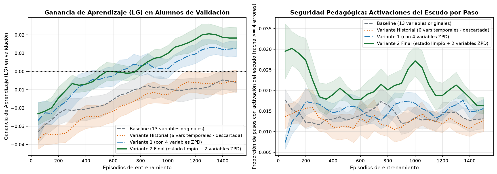
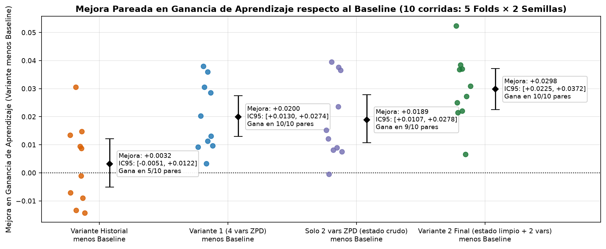

# Semana 5 · Feature Engineering + Experimentos A/B

**Sistema de Tutoría Inteligente Adaptativa (DRL) · Grupo 2 · Maestría en IA · UNI**
*Proyecto de Investigación 2 — Prof. Glen Rodríguez · rama `feature-engineering`*

[](https://colab.research.google.com/github/yasminum/SistemaTutorInteligente/blob/feature-engineering/notebooks/02_Feature_Engineering.ipynb)


---

## TL;DR

| | Resultado (10 pares fold × semilla, estudiantes **no vistos**) |
|---|---|
| **Pregunta** | ¿Qué representación del estado le permite a PPO elegir *texto × nivel* que produzcan aprendizaje real en estudiantes nuevos? |
| **Var1 `PPOlin_FS1_zpd4`** | $\Delta LG_{\text{sim}} = +0.0200$ · IC95 $[+0.0130,\ +0.0274]$ · $p_{\text{Holm}} = 0.004$ · gana en **10/10** pares · llega al LG final del baseline en **350** episodios contra **750** → **ADOPTAR** |
| **Var2 `PPOlin_FS2_hist6`** | $\Delta LG_{\text{sim}} = +0.0032$ · IC95 $[-0.0051,\ +0.0122]$ · $p_{\text{Holm}} = 0.494$ · 5/10 pares → **DESCARTAR** |
| **Costo** | +0.119 ms por decisión (mediana 0.150 ms frente a 0.031 ms) |
| **Mecanismo** | Var1 **acierta menos** (−1.4 pp) pero genera **+0.039 eventos de aprendizaje por paso** (10/10 pares): deja de elegir ítems fáciles y elige ítems dentro de la ZPD |

> Cada número de este README proviene de `data/results/` (generado por `python -m src.run_ab --all`) y del notebook ejecutado. Corrimos el experimento completo tres veces y obtuvimos resultados idénticos (determinista con semillas fijas).

---

## 1. Cumplimiento de la sesión (IA05)

| Slide | Requisito | Dónde está |
|---|---|---|
| 3–5 | Baseline + 2 variantes, **un cambio por variante**, nombres claros | §4 · `src/experiment.py::VARIANTS` |
| 6, 12 | Validación correcta: **GroupKFold por estudiante**, *fit* solo en train | §3 · `src/leakage_checks.py` (5/5 PASS) |
| 7 | Tuning ligero y trazable | 1 hiperparámetro (`lr_pi`) probado en un *pool* de desarrollo disjunto (ids 100–139), idéntico para las 3 variantes |
| 9 | Tabla estándar: métrica principal + secundarias + costo + nota + ID + ruta del log | §4.1 · `data/results/tabla_comparativa_ab.csv` |
| 10–11 | Optimización: objetivo + #evaluaciones + **violaciones** | §4.2 (curva holdout vs. episodios y tasa de shield) |
| 13 | Logs con config, métricas, costo y timestamp; snapshot con hash; versiones | `logs/metrics_experimentos.csv` · `data/SNAPSHOT.json` |
| 14 | Decisión adoptar/descartar | §5 |
| 15 | Riesgos y próximos pasos | §7 |

---

## 2. Entorno y métrica central

* **Entorno:** port numpy **fiel** de `tesis-drl-its/src/environment.py` (IRT-3PL, aprendizaje en la ventana $\lvert\theta_k-b_{adj}\rvert<0.5$, olvido multiplicativo, shield con racha ≥ 4, la misma recompensa). Diferencias declaradas: sin LSTM congelado de pesos aleatorios; sin la dimensión *andamiaje*, que el entorno recibe pero nunca usa (30 × 3 = 90 acciones); banco de ítems fijo con SHA-256 `07ed76f0bee0a21d…`.
* **Métrica central:** $LG_{\text{sim}}=\dfrac{\bar\theta^*_{post}-\bar\theta^*_{pre}}{1-\bar\theta^*_{pre}}$ calculada sobre la habilidad **verdadera** del simulador (Hake, 1998), **en estudiantes de test** y con la política congelada.
* **Agente:** PPO-clip (Schulman et al., 2017) con política softmax **lineal** (numpy). Con un aproximador lineal, la representación es el **único** factor que cambia entre variantes.

$$P(y=1)=c+\frac{1-c}{1+e^{-1.7a(\theta_k-b_{adj})}}\,(1-0.1f),\qquad b_{adj}=b+(\ell-1)\cdot0.5$$

---

## 3. Feature Engineering y control de *leakage*

### 3.1 Conjuntos de features

| Set | Rasgos | Definición |
|---|---|---|
| **FS0 `raw13`** (baseline) | $x_t\in\mathbb R^{13}$ de la Tabla 2 de la tesis, tal como lo emite el código | $[\theta_{1..3},\ \sigma_{1..3},\ u_{1..3},\ \tau_{1,2},\ \hat E,\ b_{t-1}]$ |
| **FS1 `zpd4`** (Var1) | 4 rasgos **por acción** $(j,\ell)$, promediados sobre los 10 ítems del texto $j$ | $\hat p_{j\ell}=\overline{P_{3PL}}$, $\ \overline{\lvert g\rvert}$, $\ \overline{e^{-g^2/2\sigma_F^2}}$, $\ \overline{\mathbb 1[\lvert g\rvert<0.5]}$, con $g=\theta_{k_i}-b_{adj,i}$ |
| **FS2 `hist6`** (Var2) | 6 rasgos temporales **causales** | $\text{acc}_{w5}=\frac{\sum_{s=t-5}^{t-1}y_s+1}{n+2}$, racha/5, $\text{EWMA}_{0.2}(1-y)$, one-hot($\ell_{t-1}$) |

### 3.2 Por qué estos rasgos: diagnóstico solo con estudiantes de train (10 000 interacciones)

| Representación de la distancia habilidad–dificultad | AUC para predecir "aprendió" |
|---|---|
| $-\lvert\theta-b_{adj}\rvert$ (FS1, escala del modelo generativo) | **0.925** |
| $-\lvert\theta-\sigma(b)\rvert$ (Gap de la v1, **descartada**) | 0.640 |

* **8 de los 13** rasgos de $x_t$ no llevan información en el código actual: 5 son constantes ($u_1,u_2,\tau_1,\tau_2,\hat E$) y 3 son ruido $U(0.05,0.15)$ ($\sigma$).
* Ningún rasgo de estado predice el aprendizaje por sí solo (AUC ≈ 0.50). La señal está en la **interacción** habilidad × dificultad de la acción, y un modelo lineal no puede construir $\lvert\theta-b\rvert$ a partir de $\theta$ y $b$ por separado. Esa es la justificación de FS1.
* El ítem concreto se muestrea **después** de decidir, así que FS1 usa el promedio de los ítems del texto y nunca mira el ítem del paso $t$.

### 3.3 Cero fuga: pruebas automáticas (`python -m src.leakage_checks`)

| Prueba | Resultado | Evidencia |
|---|---|---|
| L1 GroupKFold por estudiante | PASS | 5 folds de 20; intersección train/test = 0; cada id aparece en test exactamente una vez |
| L2 Causalidad temporal | PASS | 200 pruebas: features$(t)$ invariantes al alterar $y_t \dots y_H$ |
| L3 Sin espiar el ítem actual | PASS | cambiar el ítem que se muestreará en $t$ no altera $\Phi(t)$ |
| L4 *Scaler* ajustado solo en train | PASS | 18 ids distintos, todos de train; 0 de test |
| L5 Política congelada en test | PASS | pesos idénticos antes y después de evaluar |

Además: no hay *early stopping* (las curvas de test son solo descriptivas) y los hiperparámetros se fijaron en un *pool* de desarrollo disjunto de los 100 estudiantes evaluados.

---

## 4. Resultados A/B

**Diseño:** 100 estudiantes sintéticos → GroupKFold (5 folds: 80 train / 20 test) × semillas {0, 1} = **10 pares**. Mismo presupuesto: 1 500 episodios × 50 pasos = 75 000 interacciones por corrida (30 corridas). La evaluación final usa 20 estudiantes de test × 3 repeticiones, con política *greedy* y congelada.

### 4.1 Tabla estándar (Slide 9)

| ID experimento | Variante | $LG_{\text{sim}}$ holdout (media ± DE) | Acierto | Eventos de aprendizaje/paso | Violaciones (shield)/paso | Costo CMDP/paso | Episodios hasta el LG del baseline (mediana) | Latencia mediana (ms) | Nota (qué cambió) |
|---|---|:---:|:---:|:---:|:---:|:---:|:---:|:---:|---|
| `FE5-PPOlin_FS0_raw13-oracle-f*-s*` | Baseline | −0.0095 ± 0.0174 | 0.730 | 0.273 | 0.017 | 0.032 | 750 (10/10) | 0.031 | 13 rasgos $x_t$ de `environment.py` |
| `FE5-PPOlin_FS1_zpd4-oracle-f*-s*` | **Var1** | **+0.0105 ± 0.0150** | 0.716 | **0.312** | 0.016 | 0.041 | **350 (10/10)** | 0.150 | + 4 rasgos ZPD por acción |
| `FE5-PPOlin_FS2_hist6-oracle-f*-s*` | Var2 | −0.0063 ± 0.0162 | 0.737 | 0.272 | 0.015 | 0.026 | 775 (8/10) | 0.034 | + 6 rasgos temporales causales |

Log: `logs/metrics_experimentos.csv` (1 fila por corrida, con config, hashes y timestamp).
**Escala de lectura** (fold 0; no son variantes): política aleatoria −0.044; secuencia fija −0.030; heurística ZPD con oráculo +0.041; cota "acierta dentro de la ZPD en los 50 pasos" +0.326.

### 4.2 Curva holdout y violaciones (Slide 10)



### 4.3 Efecto pareado de cada cambio



| Comparación | $\Delta LG$ | IC95 bootstrap | $p$ permutación exacta | $p_{\text{Holm}}$ | $d_z$ | Pares ganados |
|---|:---:|:---:|:---:|:---:|:---:|:---:|
| Var1 − Baseline | **+0.0200** | [+0.0130, +0.0274] | 0.002 | **0.004** | 1.61 | 10/10 |
| Var2 − Baseline | +0.0032 | [−0.0051, +0.0122] | 0.494 | 0.494 | 0.22 | 5/10 |

Secundarias de Var1 frente al baseline: eventos de aprendizaje **+0.039/paso** [+0.023, +0.056], $p_{\text{Holm}}=0.004$; acierto −0.014 [−0.029, −0.000], $p_{\text{Holm}}=0.21$; violaciones −0.001 (no significativo).

---

## 5. Decisión (Slide 14)

**Regla:** se adopta una variante si (i) el IC95 de $\Delta LG$ es > 0 y $p_{\text{Holm}}<0.05$, (ii) el sobrecosto es < 1 ms por decisión y (iii) la tasa de violaciones no sube más de 0.01.

| Variante | (i) Métrica | (ii) Costo | (iii) Seguridad | Decisión |
|---|:---:|:---:|:---:|:---:|
| `PPOlin_FS1_zpd4` | ✔ | ✔ (+0.119 ms) | ✔ | **ADOPTAR** |
| `PPOlin_FS2_hist6` | ✘ | ✔ | ✔ | **DESCARTAR** (se puede re-probar sobre FS1 en el próximo sprint, como un nuevo cambio único) |

---

## 6. Prueba de estrés: del oráculo $\theta^*$ a una habilidad observable $\hat\theta$

`environment.py` le entrega al agente la $\theta^*$ verdadera, algo imposible en aula. Re-entrenamos baseline y Var1 (5 folds, semilla 0) con un estimador Elo online (Pelánek, 2016): $\hat\theta_k\leftarrow\text{clip}(\hat\theta_k+0.1\,(y-\hat P_{3PL}))$.

| | LG con $\theta^*$ | LG con $\hat\theta$ (Elo) |
|---|:---:|:---:|
| Baseline | −0.0106 | −0.0101 |
| Var1 | +0.0136 | −0.0006 |

Var1 − Baseline con $\hat\theta$: +0.0095, IC95 [−0.0035, +0.0176], 4/5 pares, $p=0.25$. **Lectura honesta:** la ventaja se mantiene en la dirección esperada, pero baja a la mitad y deja de ser significativa con 5 pares. El valor de FS1 depende de la calidad de $\hat\theta$. Por eso el siguiente paso es usar un estimador con incertidumbre (BKT/MSKT) en lugar de Elo.

---

## 7. Limitaciones, riesgos y próximos pasos

1. **Magnitud:** con olvido en cada paso y H = 50, el LG alcanzable es bajo (cota ≈ 0.33). El efecto (+0.020) es pequeño en valor absoluto, aunque es consistente (10/10). Se lee contra esa escala, no contra el 0.50 de la HG.
2. **Clase de política:** el efecto corresponde a una política lineal; con el MLP de la tesis la brecha puede reducirse. → Réplica en GPU (Semana 6).
3. **Circularidad:** `zpd_hit` usa la ventana ±0.5 del propio simulador. → Evaluación *out-of-family* con un simulador BKT (tesis §4.3).
4. **Riesgos:** deriva de calibración de $b$ cuando lleguen respuestas humanas; Beta(2, 2) sub-representa a estudiantes de habilidad muy baja.
5. **Demo de la Semana 6:** un estudiante de test en vivo, baseline contra Var1, con trazas paso a paso de $\hat p$, $\lvert g\rvert$ y $\theta^*$.

Preguntas esperadas, las tres iteraciones adversariales y el plan de "cómo sería con estudiantes reales": [`DEFENSA_FE_ADVERSARIAL.md`](DEFENSA_FE_ADVERSARIAL.md).

---

## 8. Reproducibilidad (Slide 13)

```bash
pip install -r requirements.txt                    # numpy, pandas, matplotlib (sin PyTorch)
python -m src.leakage_checks                       # 5 pruebas de fuga
python -m src.run_ab --variant PPOlin_FS0_raw13    # Baseline
python -m src.run_ab --variant PPOlin_FS1_zpd4     # Var1
python -m src.run_ab --variant PPOlin_FS2_hist6    # Var2
python -m src.run_ab --all --robustness --workers 6   # todo (~3 min con 6 núcleos)
jupyter notebook notebooks/02_Feature_Engineering.ipynb
```

| Artefacto | Valor |
|---|---|
| Snapshot de datos | `data/item_bank.csv` · SHA-256 `07ed76f0bee0a21d…` · 300 filas (`data/SNAPSHOT.json`) |
| Código que determina los resultados | SHA-256 `8a026bbfc7285b26…` (simulator, feature_engineering, agent, experiment) |
| Versiones | Python 3.11.15 · numpy 2.4.6 · pandas 3.0.6 · matplotlib 3.11.2 |
| Logs | `logs/metrics_experimentos.csv`, `data/results/runs_oracle.json`, `runs_elo.json`, `references.json`, `summary.json` |

```text
feature-engineering/
├── README.md                         ← este informe
├── DEFENSA_FE_ADVERSARIAL.md         ← 3 iteraciones adversariales + preguntas esperadas + plan real
├── requirements.txt
├── notebooks/02_Feature_Engineering.ipynb   ← ejecutado, con todas las salidas
├── src/
│   ├── simulator.py                  ← port fiel de environment.py
│   ├── feature_engineering.py        ← FS0/FS1/FS2, historial causal, Elo, scaler con procedencia
│   ├── agent_ppo_linear.py           ← PPO-clip lineal (numpy)
│   ├── experiment.py                 ← GroupKFold, entrenamiento, evaluación, estadística, logging
│   ├── leakage_checks.py             ← pruebas L1–L5
│   ├── diagnostics.py                ← AUC de features (solo train)
│   ├── report.py                     ← tablas y figuras
│   └── run_ab.py                     ← CLI
├── data/  item_bank.csv · SNAPSHOT.json · sample/ · results/
├── logs/metrics_experimentos.csv
└── figures/fe/*.png
```

## Referencias

* Birnbaum, A. (1968). Some latent trait models. En Lord & Novick, *Statistical Theories of Mental Test Scores*. Addison-Wesley.
* Hake, R. R. (1998). Interactive-engagement versus traditional methods. *American Journal of Physics, 66*(1), 64–74. https://doi.org/10.1119/1.18809
* Kaufman, S., Rosset, S., Perlich, C., & Stitelman, O. (2012). Leakage in data mining: Formulation, detection, and avoidance. *ACM TKDD, 6*(4), 1–21. https://doi.org/10.1145/2382577.2382579
* Pelánek, R. (2016). Applications of the Elo rating system in adaptive educational systems. *Computers & Education, 98*, 169–179. https://doi.org/10.1016/j.compedu.2016.03.017
* Schulman, J., Wolski, F., Dhariwal, P., Radford, A., & Klimov, O. (2017). Proximal policy optimization algorithms. arXiv:1707.06347.
* Doroudi, S., Aleven, V., & Brunskill, E. (2019). Where's the reward? A review of reinforcement learning for instructional sequencing. *IJAIED, 29*, 568–620. https://doi.org/10.1007/s40593-019-00187-x
